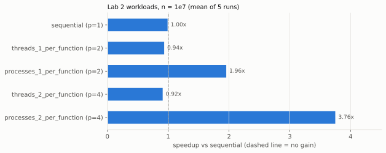

# 01 Threads vs processes

## What it is

Two CPU-bound pure-Python loops: add n random integers, and join n random characters into a string. I run them five ways; each configuration runs once untimed as a warm-up, then 5 timed runs, and the median counts:

- sequential (one after the other),
- one thread per function (2 threads), one process per function (2 processes),
- two threads per function (4 threads), two processes per function (4 processes), where each function's n is split in half.

Every configuration does exactly the same work as the sequential run, with the same seeds, and the combined result is compared with the sequential result before any time is reported.

## Result (n = 1e7 per function)

<!-- table: t01 -->
| Configuration | Workers p | Median time (s) of 5 | Mean ± sd (s) | Speedup (medians) | Efficiency S/p |
|---|---|---|---|---|---|
| sequential | 1 | 6.11 | 6.07 ± 0.09 | 1.00x | 1.00 |
| threads_1_per_function | 2 | 6.55 | 6.55 ± 0.09 | 0.93x | 0.47 |
| processes_1_per_function | 2 | 3.35 | 3.34 ± 0.21 | 1.82x | 0.91 |
| threads_2_per_function | 4 | 6.46 | 6.50 ± 0.10 | 0.95x | 0.24 |
| processes_2_per_function | 4 | 1.58 | 1.61 ± 0.08 | 3.86x | 0.97 |
<!-- /table -->



## What it shows: the GIL

Threads made this work slower, not faster: 0.93x<!-- claim: 01_threads_vs_processes/threads_vs_processes_n10000000.json | rows[config=threads_1_per_function].speedup | {:.2f}x --> with 2 threads and 0.95x<!-- claim: 01_threads_vs_processes/threads_vs_processes_n10000000.json | rows[config=threads_2_per_function].speedup | {:.2f}x --> with 4. Both loops are pure Python, and CPython's global interpreter lock (GIL) lets only one thread run Python bytecode at a time, so the threads take turns on one core and pay for the switching. Processes each have their own interpreter and their own GIL, so they really run in parallel: 1.82x<!-- claim: 01_threads_vs_processes/threads_vs_processes_n10000000.json | rows[config=processes_1_per_function].speedup | {:.2f}x --> with 2 processes and 3.86x<!-- claim: 01_threads_vs_processes/threads_vs_processes_n10000000.json | rows[config=processes_2_per_function].speedup | {:.2f}x --> with 4 on this 4-core machine (efficiency 0.97<!-- claim: 01_threads_vs_processes/threads_vs_processes_n10000000.json | rows[config=processes_2_per_function].efficiency | {:.2f} -->).

Rule I take from this: for CPU-bound pure-Python code, threads do not help; use processes (or move the loop into a library that releases the GIL, see 02 and 06). Python 3.13 has an optional free-threaded build without the GIL; I did not test it here.

## Bugs fixed in the earlier version

- **Different workload in the process cell.** The notebook's "processes" cell ran the numbers function twice instead of numbers plus letters, so its speedup compared two different jobs. Now every configuration runs the same tasks and must return the same answer.
- **Wrong p in the efficiency.** Efficiency was divided by `np = 4` although only 2 workers ran. Efficiency is now speedup divided by the real number of workers (`bench_common.efficiency`); a regression test checks it with 2 workers.
- **Windows (spawn) could not run the process cell,** because the worker functions were defined inside the notebook. They now live in `threads_vs_processes/workloads.py`, and the notebook imports them.
- Two identical "two threads" cells with different labels were removed, and Amdahl's law now uses the number of workers instead of infinitely many.

## How to run

```bash
python -m threads_vs_processes.benchmark                 # n = 1e7, 5 repeats, writes results/01_threads_vs_processes/
python -m threads_vs_processes.benchmark --n 1000000 --repeats 3 --no-save    # quick look
python -m pytest 01_threads_vs_processes
```

The notebook (`threads_vs_processes.ipynb`) runs the same workloads step by step. CI runs it headless with `python tools/run_notebooks.py`.
