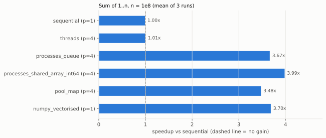

# 02 Parallel sum of 1..n (from Lab 3 parts 1 and 2)

Originally Lab 3 of DSAI3202 (UDST, Spring 2025). Part 2 (`L3-P2`) was my first set of standalone scripts, part 1 (`L3-P1`) the reorganised version with `main.py`. Both are merged here and fixed in 2026.

## What it is

Sum the integers 1..n by splitting the range into chunks, six ways: sequential `sum(range())`, 4 threads, 4 processes returning partial sums through a `Queue`, 4 processes writing into a shared `multiprocessing.Array`, `Pool.map`, and NumPy on one core. Every answer is checked against n(n+1)/2 before its time counts.

## Result (4-core machine, 3 runs each)

<!-- table: t02 -->
| n | Method | p | Time (s), mean ± sd of 3 | Speedup | Efficiency | Sum correct |
|---|---|---|---|---|---|---|
| 1e+06 | sequential | 1 | 0.0140 ± 0.0006 | 1.00x | 1.00 | yes |
| 1e+06 | threads | 4 | 0.0149 ± 0.0004 | 0.94x | 0.23 | yes |
| 1e+06 | processes_queue | 4 | 0.0109 ± 0.0003 | 1.28x | 0.32 | yes |
| 1e+06 | processes_shared_array_int64 | 4 | 0.0097 ± 0.0002 | 1.43x | 0.36 | yes |
| 1e+06 | pool_map | 4 | 0.0155 ± 0.0001 | 0.90x | 0.22 | yes |
| 1e+06 | numpy_vectorised | 1 | 0.0135 ± 0.0115 | 1.04x | 1.04 | yes |
| 1e+07 | sequential | 1 | 0.1445 ± 0.0017 | 1.00x | 1.00 | yes |
| 1e+07 | threads | 4 | 0.1473 ± 0.0055 | 0.98x | 0.25 | yes |
| 1e+07 | processes_queue | 4 | 0.0438 ± 0.0010 | 3.30x | 0.82 | yes |
| 1e+07 | processes_shared_array_int64 | 4 | 0.0410 ± 0.0015 | 3.52x | 0.88 | yes |
| 1e+07 | pool_map | 4 | 0.0567 ± 0.0085 | 2.55x | 0.64 | yes |
| 1e+07 | numpy_vectorised | 1 | 0.1576 ± 0.2364 | 0.92x | 0.92 | yes |
| 1e+08 | sequential | 1 | 1.4692 ± 0.0977 | 1.00x | 1.00 | yes |
| 1e+08 | threads | 4 | 1.4537 ± 0.0250 | 1.01x | 0.25 | yes |
| 1e+08 | processes_queue | 4 | 0.4000 ± 0.0520 | 3.67x | 0.92 | yes |
| 1e+08 | processes_shared_array_int64 | 4 | 0.3681 ± 0.0188 | 3.99x | 1.00 | yes |
| 1e+08 | pool_map | 4 | 0.4216 ± 0.0048 | 3.48x | 0.87 | yes |
| 1e+08 | numpy_vectorised | 1 | 0.3976 ± 0.2303 | 3.70x | 3.70 | yes |
<!-- /table -->



## What it shows

- **Small inputs do not pay for processes.** At n = 1e6 the whole sequential sum takes 0.0140 s<!-- claim: 02_parallel_sum/parallel_sum.json | rows[n=1000000,method=sequential].mean_s | {:.4f} s -->, and starting 4 processes costs about as much as the work: `Pool.map` came out at 0.90x<!-- claim: 02_parallel_sum/parallel_sum.json | rows[n=1000000,method=pool_map].speedup | {:.2f}x --> and the best process version at 1.43x<!-- claim: 02_parallel_sum/parallel_sum.json | rows[n=1000000,method=processes_shared_array_int64].speedup | {:.2f}x -->.
- **Large inputs do.** At n = 1e8 the 4-process versions reached 3.67x<!-- claim: 02_parallel_sum/parallel_sum.json | rows[n=100000000,method=processes_queue].speedup | {:.2f}x --> (Queue), 3.99x<!-- claim: 02_parallel_sum/parallel_sum.json | rows[n=100000000,method=processes_shared_array_int64].speedup | {:.2f}x --> (shared Array) and 3.48x<!-- claim: 02_parallel_sum/parallel_sum.json | rows[n=100000000,method=pool_map].speedup | {:.2f}x --> (`Pool.map`).
- **Threads never help** here (1.01x<!-- claim: 02_parallel_sum/parallel_sum.json | rows[n=100000000,method=threads].speedup | {:.2f}x --> at 1e8), for the same GIL reason as in 01.
- **Why NumPy can match or beat 4 processes on a single core.** `sum(range(...))` makes Python create and add one integer object per step. NumPy fills a typed int64 array and adds it with a compiled loop (with SIMD instructions), so one core does far more additions per second, and there is no process start-up or result passing. Here NumPy on one core took 0.3976 s<!-- claim: 02_parallel_sum/parallel_sum.json | rows[n=100000000,method=numpy_vectorised].mean_s | {:.4f} s --> at 1e8, about the same as the 4-process versions (0.3681 s<!-- claim: 02_parallel_sum/parallel_sum.json | rows[n=100000000,method=processes_shared_array_int64].mean_s | {:.4f} s --> to 0.4216 s<!-- claim: 02_parallel_sum/parallel_sum.json | rows[n=100000000,method=pool_map].mean_s | {:.4f} s -->). Its three runs varied a lot (standard deviation 0.2303 s<!-- claim: 02_parallel_sum/parallel_sum.json | rows[n=100000000,method=numpy_vectorised].sd_s | {:.4f} s -->; the individual runs are in the JSON), so I would call it a tie on this machine, not a win. The lesson I take: vectorise first, then parallelise what is left.

## What was wrong in 2025 and how I fixed it

- **int32 overflow (L3-P2).** The shared array was `multiprocessing.Array('i', ...)`, a signed 32-bit int. Each partial sum above 2,147,483,647 wrapped around, so n = 1e6 returned 1,784,293,664 instead of 500,000,500,000, with no error. Fixed with `Array('q')` (64-bit). The same function called with `typecode="i"` still gives exactly 1,784,293,664, which the regression test checks, together with running the original 2025 file.
- **Modules named like the standard library (L3-P2).** `src/multiprocessing.py` and `src/threading.py` were imported instead of the real modules when run as scripts (`AttributeError: module 'multiprocessing' has no attribute 'Array'`). Renamed into the `parallel_sum` package; a test fails if any file in the repo is named like a stdlib module.
- **Nested worker functions (L3-P1).** The workers were defined inside the functions that started them, which cannot be pickled under the "spawn" start method (Windows and macOS default): `Can't pickle local object`. They are module level now, and the tests run under spawn.
- **Wrong Gustafson formula (L3-P1).** `main.py` printed N - (1 - P)N = 3.60 for N = 4, P = 0.9. Gustafson's law is S = N - (1 - P)(N - 1) = 3.70 (`parallel_sum/laws.py`).
- **Tests that could not run.** All 3 test files imported modules that did not exist on their branch (0 of 3 collected on L3-P1). They now import the real modules, and property tests check every method against n(n+1)/2 for random n.

## How to run

```bash
python 02_parallel_sum/main.py 1e7 4          # the Lab 3 comparison (sequential, threads, processes) with speedups and laws
python -m parallel_sum.benchmark              # the table above: n = 1e6, 1e7, 1e8
python -m pytest 02_parallel_sum
```
