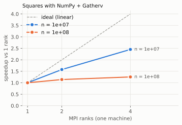

# 05 MPI squares on one or more machines (from Lab 6)

Originally Lab 6 of DSAI3202 (UDST, Spring 2025). Rewritten in 2026 for large n on one machine. `calculate_squares.py` was provided by the course staff and is modified by me (see its header and `CREDITS.md`).

## What it is

Compute the squares of 1..n spread over MPI ranks, collect them at rank 0, and print the length, the last square and the time. `mpi_program.py` is the standard mpi4py send/recv example; `mpi_test.py` prints which host each rank runs on.

## 2025 evidence: two university Linux VMs

In April 2025 I ran `mpiexec -np 2 -hostfile machines.txt python mpi_program.py` across two university lab Linux virtual machines, with passwordless SSH between them and the same Python environment on both. Rank 0 on the first VM sent a dictionary to rank 1 on the second VM, which printed it. The evidence is a terminal screenshot in my private coursework repository; it is not copied here because it shows the lab machines' hostnames and user name, and the hostfile (`machines.txt`) holds the lab IP addresses. `hostfile.example` shows the format with placeholder names.

**All 2026 runs below are on a single machine** (4 cores). I have not re-run anything across machines in 2026.

## What was wrong in 2025 and how I fixed it

- **n = 1e8 ran out of memory.** Each rank built a Python list of NumPy scalars and rank 0 collected them with `comm.gather` (pickled objects). Measured in this session (below), n = 1e7 already needed about 3 GB on rank 0, too much to reach 1e8 on a 15 GB machine. Now each rank fills one int64 array and rank 0 receives the pieces straight into one preallocated array with `comm.Gatherv` (a buffer copy, no pickling). `--no-gather` goes further: only the length, the last square and a checksum are combined with `comm.reduce`, and no rank ever holds all the squares.
- **n was hard-coded to 10, and the script printed the whole list** (as `np.int64(1)`, ... with NumPy 2) instead of the length, last square and time the brief asked for. n now comes from the command line.
- **`mpi_program.py` crashed with one rank** (`MPI_ERR_RANK: invalid rank`, it sent to rank 1 which did not exist). With one rank it now sends to itself.

## Result: single machine, n = 1e7 and 1e8, 1/2/4 ranks, 10 runs each (plus one untimed warm-up)

Gather everything at rank 0 (`Gatherv`):

<!-- table: t05_gatherv -->
| n | Ranks | Time (s), mean ± sd of 10 | Speedup vs 1 rank | Efficiency | Peak memory rank 0 (MB) |
|---|---|---|---|---|---|
| 1e+07 | 1 | 0.104 ± 0.097 | 1.00x | 1.00 | 193 |
| 1e+07 | 2 | 0.045 ± 0.003 | 2.29x | 1.15 | 155 |
| 1e+07 | 4 | 0.136 ± 0.124 | 0.77x | 0.19 | 136 |
| 1e+08 | 1 | 1.641 ± 1.093 | 1.00x | 1.00 | 1566 |
| 1e+08 | 2 | 0.828 ± 0.797 | 1.98x | 0.99 | 1185 |
| 1e+08 | 4 | 1.233 ± 0.972 | 1.33x | 0.33 | 995 |
<!-- /table -->

Reduce only (`--no-gather`):

<!-- table: t05_reduce -->
| n | Ranks | Time (s), mean ± sd of 10 | Speedup vs 1 rank | Efficiency | Peak memory rank 0 (MB) |
|---|---|---|---|---|---|
| 1e+07 | 1 | 0.038 ± 0.005 | 1.00x | 1.00 | 117 |
| 1e+07 | 2 | 0.020 ± 0.002 | 1.87x | 0.94 | 79 |
| 1e+07 | 4 | 0.012 ± 0.003 | 3.05x | 0.76 | 60 |
| 1e+08 | 1 | 0.862 ± 0.770 | 1.00x | 1.00 | 803 |
| 1e+08 | 2 | 0.735 ± 0.467 | 1.17x | 0.59 | 422 |
| 1e+08 | 4 | 0.295 ± 0.209 | 2.92x | 0.73 | 231 |
<!-- /table -->



**The reliable win is memory.** I measured the 2025 script in this session with only n changed (`tools/measure_2025_mpi.py`): at n = 1e7 its rank 0 peaked at 2969 MB<!-- claim: 05_mpi_multi_node/legacy_2025_calculate_squares.json | rows[n=10000000,ranks=1].peak_rss_mb_rank0 | {:.0f} MB --> with 1 rank and the run took 49.3 s<!-- claim: 05_mpi_multi_node/legacy_2025_calculate_squares.json | rows[n=10000000,ranks=1].wall_s_incl_startup | {:.1f} s -->. Memory grows linearly with n, so 1e8 would need roughly ten times that, about 30 GB, which this 15 GB machine does not have; I did not run it. The 2026 version handles n = 1e8 with 1566 MB<!-- claim: 05_mpi_multi_node/mpi_squares_scaling_gatherv.json | rows[n=100000000,ranks=1].peak_rss_mb_rank0_max | {:.0f} MB --> on rank 0 when it gathers everything (the 800 MB result plus its own 800 MB piece), and with 231 MB<!-- claim: 05_mpi_multi_node/mpi_squares_scaling_reduce_only.json | rows[n=100000000,ranks=4].peak_rss_mb_rank0_max | {:.0f} MB --> per rank in reduce-only mode with 4 ranks.

**The speedups are small and noisy, and I do not read much into them.** Squaring is one multiplication per 8 bytes of memory, so the run time is mostly allocating and touching memory, not computing; each timed run is well under 2 seconds and the standard deviations are as large as some means, even with 10 runs. Where the work is not dominated by one big allocation it scales: reduce-only at n = 1e7 went from 0.038 s<!-- claim: 05_mpi_multi_node/mpi_squares_scaling_reduce_only.json | rows[n=10000000,ranks=1].mean_s | {:.3f} s --> on 1 rank to 3.05x<!-- claim: 05_mpi_multi_node/mpi_squares_scaling_reduce_only.json | rows[n=10000000,ranks=4].speedup_vs_1_rank | {:.2f}x --> on 4. With `Gatherv` all squares still have to be copied into one 800 MB array on rank 0, which is a single-machine memory copy that more ranks cannot speed up: 4 ranks were slower than 2 at n = 1e8 (1.33x<!-- claim: 05_mpi_multi_node/mpi_squares_scaling_gatherv.json | rows[n=100000000,ranks=4].speedup_vs_1_rank | {:.2f}x --> vs 1.98x<!-- claim: 05_mpi_multi_node/mpi_squares_scaling_gatherv.json | rows[n=100000000,ranks=2].speedup_vs_1_rank | {:.2f}x -->). On one machine, MPI is the wrong tool for a job this light; it is the tool for when the data or the work does not fit on one machine, which is what the 2025 two-VM run was about.

## How to run

```bash
# needs an MPI runtime (Linux: apt install openmpi-bin libopenmpi-dev) and pip install -r requirements-mpi.txt
mpiexec -n 4 python 05_mpi_multi_node/calculate_squares.py 1e8
mpiexec -n 4 python 05_mpi_multi_node/calculate_squares.py 1e8 --no-gather
mpiexec -n 1 python 05_mpi_multi_node/mpi_program.py
python -m mpi_squares.scaling                    # the tables above
python -m pytest 05_mpi_multi_node               # MPI tests are skipped when no MPI runtime is installed
```

Across machines (what I did in 2025): copy `hostfile.example` to `hostfile`, put your machine names in it, set up passwordless SSH from the first machine to the others, install the same Python environment at the same path on every machine, then run `mpiexec -n 4 --hostfile hostfile python 05_mpi_multi_node/calculate_squares.py 1e8`.
