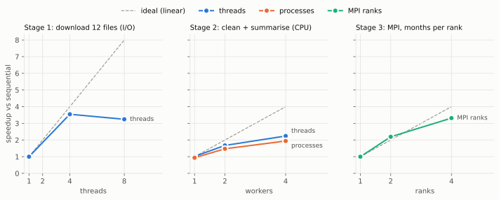
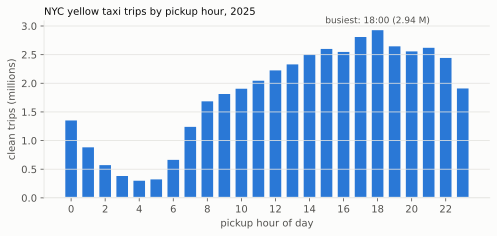

# 06 NYC taxi pipeline

This folder applies what folders 01 to 05 show to a real, public dataset.

## What it is

A four-stage pipeline over every NYC yellow taxi trip of 2025 (12 monthly Parquet files from the NYC Taxi and Limousine Commission), built to test the rule of thumb from folders 01 to 05 on real data:

1. **Stage 1 (I/O-bound):** download the 12 files sequentially and with a `ThreadPoolExecutor` of 4 and 8 threads, one untimed warm-up and then 3 timed runs each. Every run downloads into a fresh temporary folder, so nothing is served from a local copy.
2. **Stage 2 (CPU-bound):** for each month, read the file, apply the cleaning rules and compute summaries; sequential vs threads vs processes with 1, 2 and 4 workers, one untimed warm-up and then 3 timed runs each. All methods must produce identical summaries.
3. **Stage 3 (MPI):** the same work with `mpiexec -n 1/2/4`, months dealt round-robin to the ranks, summaries gathered at rank 0. Checked against the sequential result.
4. **Stage 4 (SQL):** the monthly summaries go into SQLite (Python `sqlite3`), and five questions are answered by the SQL files in `sql/`.

## Data

NYC TLC Trip Record Data, https://www.nyc.gov/site/tlc/about/tlc-trip-record-data.page. Published by the City of New York; use is subject to the NYC.gov terms of use (https://www.nyc.gov/home/terms-of-use.page). `python -m nyc_taxi.download` fetches the files into `data/nyc_taxi/` (ignored by git) and writes the manifest below. Nothing from the dataset is committed; the test fixtures in `tests/fixtures/taxi/` are 1,002 synthetic trips in the same column layout.

<!-- table: t06_manifest -->
| File | Bytes | Rows | SHA-256 (first 16 hex) |
|---|---|---|---|
| yellow_tripdata_2025-01.parquet | 59,158,238 | 3,475,226 | `9af277e4c0d3f9de…` |
| yellow_tripdata_2025-02.parquet | 60,343,086 | 3,577,543 | `037cba555a73663f…` |
| yellow_tripdata_2025-03.parquet | 69,964,745 | 4,145,257 | `20c4b77cce457b7c…` |
| yellow_tripdata_2025-04.parquet | 67,352,824 | 3,970,553 | `6f98938de9380a3f…` |
| yellow_tripdata_2025-05.parquet | 77,837,865 | 4,591,845 | `7ef46bcd0fceee7f…` |
| yellow_tripdata_2025-06.parquet | 73,542,954 | 4,322,960 | `1bea7f5b09c74441…` |
| yellow_tripdata_2025-07.parquet | 66,943,728 | 3,898,963 | `1efa6a0458dc6034…` |
| yellow_tripdata_2025-08.parquet | 62,293,743 | 3,574,091 | `b982ace703e3564d…` |
| yellow_tripdata_2025-09.parquet | 72,432,945 | 4,251,015 | `cd39b9901f01d1fd…` |
| yellow_tripdata_2025-10.parquet | 75,267,589 | 4,428,699 | `e1f63caf331bc623…` |
| yellow_tripdata_2025-11.parquet | 71,134,255 | 4,181,444 | `2cf2f3127f96d4d5…` |
| yellow_tripdata_2025-12.parquet | 73,701,327 | 4,305,006 | `eaba7ff61ebb6453…` |
| **total** | 829,973,299 | 48,722,602 |  |
<!-- /table -->

## Cleaning rules

Applied in this order to the columns the summaries need (pickup and dropoff time, passenger count, distance, fare, pickup zone). A removed trip is counted once, under the first rule it fails (`src/nyc_taxi/cleaning.py`):

1. `pickup_outside_month`: the pickup time is not in the file's month (the files contain some trips from other months and years).
2. `bad_duration`: under 1 minute or over 6 hours, which includes dropoffs before pickups.
3. `bad_distance`: missing, 0 or less, or over 100 miles.
4. `bad_fare`: missing, 0 or less, or over 500 USD.
5. `bad_passenger_count`: 0 or more than 6. A missing value is kept as "unknown": 23.8%<!-- claim: 06_nyc_taxi_pipeline/stage2_cpu.json | yearly.passenger_count_missing_share | {:.1%} --> of 2025 trips have no passenger count, and dropping them would lose about a quarter of the year.
6. `unknown_pickup_zone`: not a known zone 1-263 (264 and 265 are "Unknown" and "Outside of NYC").

<!-- table: t06_cleaning -->
| Rule (applied in order) | Trips | Share of all trips |
|---|---|---|
| pickup_outside_month | 214 | 0.00% |
| bad_duration | 1,106,207 | 2.27% |
| bad_distance | 1,021,706 | 2.10% |
| bad_fare | 2,578,885 | 5.29% |
| bad_passenger_count | 248,775 | 0.51% |
| unknown_pickup_zone | 78,218 | 0.16% |
| **kept** | 43,688,597 | 89.67% |
<!-- /table -->

## Results (4-core machine, one untimed warm-up, then 3 timed runs each)

### Stage 1: downloads (I/O-bound)

<!-- table: t06_stage1 -->
| Threads | Median time for 12 files (s) of 3 | Mean ± sd (s) | Speedup (medians) | Throughput (MB/s) | Short transfers retried |
|---|---|---|---|---|---|
| 1 | 42.77 | 42.63 ± 9.84 | 1.00x | 19 | 0 |
| 4 | 11.53 | 11.61 ± 0.39 | 3.71x | 72 | 0 |
| 8 | 6.30 | 6.52 ± 0.59 | 6.79x | 132 | 0 |
<!-- /table -->

Threads help a lot here: 3.71x<!-- claim: 06_nyc_taxi_pipeline/stage1_download.json | rows[workers=4].speedup_vs_first | {:.2f}x --> with 4 threads. A thread waiting for the network releases the GIL, and one connection did not use the whole available bandwidth, so several connections in parallel moved several times as much data per second. 8 threads went further (6.79x<!-- claim: 06_nyc_taxi_pipeline/stage1_download.json | rows[workers=8].speedup_vs_first | {:.2f}x -->). These numbers belong to that VM's network path, and the single-thread runs varied a lot (see the mean ± sd), so they are not a general rule. Some transfers ended early without an error; the downloader compares every file with its `Content-Length`, retries short ones, and the table counts the retries (they are included in the times).

### Stage 2: clean and summarise (CPU-bound)

<!-- table: t06_stage2 -->
| Method | Workers | Median time (s) of 3 | Mean ± sd (s) | Speedup (medians) | Efficiency | Identical summaries |
|---|---|---|---|---|---|---|
| sequential | 1 | 5.95 | 5.94 ± 0.05 | 1.00x | 1.00 | yes |
| threads | 1 | 6.03 | 6.05 ± 0.02 | 0.99x | 0.99 | yes |
| threads | 2 | 3.75 | 3.75 ± 0.07 | 1.59x | 0.79 | yes |
| threads | 4 | 2.78 | 2.81 ± 0.06 | 2.14x | 0.54 | yes |
| processes | 1 | 6.55 | 6.60 ± 0.14 | 0.91x | 0.91 | yes |
| processes | 2 | 3.80 | 3.79 ± 0.04 | 1.57x | 0.78 | yes |
| processes | 4 | 2.64 | 2.60 ± 0.17 | 2.26x | 0.56 | yes |
<!-- /table -->

**Threads helped here about as much as processes** (default settings): 2.14x<!-- claim: 06_nyc_taxi_pipeline/stage2_cpu.json | rows[method=threads,workers=4].speedup | {:.2f}x --> with 4 threads against 2.26x<!-- claim: 06_nyc_taxi_pipeline/stage2_cpu.json | rows[method=processes,workers=4].speedup | {:.2f}x --> with 4 processes, a gap too small to rank on one machine. That looks like it breaks the rule from 01, but most of this work does not run as Python bytecode: PyArrow decodes Parquet in C++ and pandas does the comparisons, date arithmetic and group counts in compiled code, and both release the GIL while they do it. The Python part is only the glue between those calls.

There is a second effect I checked instead of guessing. PyArrow has its own thread pool, so even the "sequential" run already uses several cores while it decodes a file. I ran stage 2 again with Arrow limited to one thread (`OMP_NUM_THREADS=1`, results in `stage2_cpu_arrow_1_thread.json`):

<!-- table: t06_stage2_arrow1 -->
| Method | Workers | Median time (s) of 3 | Mean ± sd (s) | Speedup (medians) | Efficiency | Identical summaries |
|---|---|---|---|---|---|---|
| sequential | 1 | 8.50 | 8.43 ± 0.17 | 1.00x | 1.00 | yes |
| threads | 1 | 8.16 | 8.15 ± 0.01 | 1.04x | 1.04 | yes |
| threads | 2 | 5.45 | 5.56 ± 0.25 | 1.56x | 0.78 | yes |
| threads | 4 | 4.43 | 4.39 ± 0.07 | 1.92x | 0.48 | yes |
| processes | 1 | 8.49 | 8.50 ± 0.04 | 1.00x | 1.00 | yes |
| processes | 2 | 4.31 | 4.32 ± 0.05 | 1.97x | 0.99 | yes |
| processes | 4 | 2.37 | 2.35 ± 0.06 | 3.59x | 0.90 | yes |
<!-- /table -->

With one Arrow thread the sequential run got slower (8.43 s<!-- claim: 06_nyc_taxi_pipeline/stage2_cpu_arrow_1_thread.json | rows[method=sequential,workers=1].mean_s | {:.2f} s --> instead of 5.94 s<!-- claim: 06_nyc_taxi_pipeline/stage2_cpu.json | rows[method=sequential,workers=1].mean_s | {:.2f} s -->), threads gained less (1.92x<!-- claim: 06_nyc_taxi_pipeline/stage2_cpu_arrow_1_thread.json | rows[method=threads,workers=4].speedup | {:.2f}x -->) and processes gained more (3.59x<!-- claim: 06_nyc_taxi_pipeline/stage2_cpu_arrow_1_thread.json | rows[method=processes,workers=4].speedup | {:.2f}x -->). So in the default run, 4 processes each started their own Arrow threads on a 4-core machine and competed for the same cores, and part of the "parallelism" was already inside the library. My conclusion: for pandas/PyArrow work, try threads first because they are cheap and the libraries release the GIL; processes win when the Python part is larger or when the library's own threading is turned off; and check what the library already does before adding workers on top of it.

### Stage 3: MPI on one machine

<!-- table: t06_stage3 -->
| Ranks | Binding | Median time (s) of 3 | Mean ± sd (s) | Speedup vs 1 rank | Speedup vs sequential | Efficiency | Wall time incl. start-up (s) | Identical summaries |
|---|---|---|---|---|---|---|---|---|
| 1 | Open MPI default | 8.11 | 8.14 ± 0.07 | 1.00x | 0.77x | 1.00 | 8.94 | yes |
| 2 | Open MPI default | 4.36 | 4.39 ± 0.12 | 1.86x | 1.42x | 0.93 | 5.20 | yes |
| 4 | Open MPI default | 2.38 | 2.37 ± 0.03 | 3.41x | 2.61x | 0.85 | 3.38 | yes |
| 1 | `--bind-to none` (extra run) | 6.09 | 6.11 ± 0.13 | 1.33x | 1.02x | 1.33 | 6.94 | yes |
<!-- /table -->

MPI with 4 ranks reached 3.41x<!-- claim: 06_nyc_taxi_pipeline/stage3_mpi.json | rows[ranks=4].speedup_vs_1_rank | {:.2f}x --> over 1 rank and 2.61x<!-- claim: 06_nyc_taxi_pipeline/stage3_mpi.json | rows[ranks=4].speedup_vs_sequential | {:.2f}x --> over sequential Python (2.37 s<!-- claim: 06_nyc_taxi_pipeline/stage3_mpi.json | rows[ranks=4].mean_s | {:.2f} s -->), a little faster than 4 threads in stage 2 (2.81 s<!-- claim: 06_nyc_taxi_pipeline/stage2_cpu.json | rows[method=threads,workers=4].mean_s | {:.2f} s -->). The 1-rank run itself took 8.14 s<!-- claim: 06_nyc_taxi_pipeline/stage3_mpi.json | rows[ranks=1].mean_s | {:.2f} s -->, slower than stage 2's sequential run. The saved binding report (`bindings` in `stage3_mpi.json`) explains it: Open MPI bound the 1-rank and 2-rank runs to one core per rank, so a single rank could not use PyArrow's extra threads the way the sequential Python run can; the 4 ranks were not bound. The extra `--bind-to none` row supports this: one unbound rank ran about as fast as sequential Python. That is why the speedup vs 1 rank looks better than the speedup vs sequential. Starting the ranks added about one second each time (the "wall time incl. start-up" column). All three rank counts produced summaries identical to the sequential run. On one machine MPI gave about the same benefit as a pool of threads or processes; it would matter with more months than one machine can hold or process in time.



### Stage 4: SQL answers for 2025

<!-- table: t06_sql -->
| Question | Answer (TLC data for 2025) | SQL file |
|---|---|---|
| 1. Busiest hour of day | 18:00 to 18:59, 2,944,122 trips | `q1_busiest_hour.sql` |
| 2. Average fare by month | lowest 2025-01 $17.92, highest 2025-12 $22.46 | `q2_average_fare_by_month.sql` |
| 3. Top 10 pickup zones | top 3: Upper East Side South (1,979,773), Midtown Center (1,930,397), JFK Airport (1,850,618) | `q3_top10_pickup_zones.sql` |
| 4. Month with the longest average trip | 2025-08: 3.84 miles, 17.3 minutes | `q4_longest_average_trip_month.sql` |
| 5. Share of trips cleaned out | 6.8% (2025-12) to 13.8% (2025-11) | `q5_share_cleaned_out.sql` |
<!-- /table -->

Top 10 pickup zones:

<!-- table: t06_top10 -->
| # | Zone | Borough | Clean trips |
|---|---|---|---|
| 1 | Upper East Side South | Manhattan | 1,979,773 |
| 2 | Midtown Center | Manhattan | 1,930,397 |
| 3 | JFK Airport | Queens | 1,850,618 |
| 4 | Upper East Side North | Manhattan | 1,730,402 |
| 5 | Penn Station/Madison Sq West | Manhattan | 1,430,791 |
| 6 | Midtown East | Manhattan | 1,400,074 |
| 7 | Times Sq/Theatre District | Manhattan | 1,380,473 |
| 8 | Lincoln Square East | Manhattan | 1,273,175 |
| 9 | LaGuardia Airport | Queens | 1,213,038 |
| 10 | Union Sq | Manhattan | 1,178,798 |
<!-- /table -->



The tests build the same database from the synthetic fixtures and check all five SQL answers against a separate pandas implementation of the cleaning rules (written with `DataFrame.query`, not the pipeline's code).

## How to run

```bash
python -m nyc_taxi.download                  # 12 files into data/nyc_taxi/ (sizes in the manifest above)
python -m nyc_taxi.stage1_io                 # downloads the whole year 12 times (3 settings x (1 warm-up + 3 runs)) into temporary folders
python -m nyc_taxi.stage2_cpu
python -m nyc_taxi.stage3_mpi                # needs an MPI runtime and mpi4py
python -m nyc_taxi.stage4_sql
python -m pytest 06_nyc_taxi_pipeline        # uses only the synthetic fixtures; tests cannot reach the internet
```

Limits: one machine, one year, timings from one 4-core cloud container. 48,722,602<!-- claim: 06_nyc_taxi_pipeline/stage2_cpu.json | yearly.rows_raw | {:,} --> trips is a real dataset but not "big data"; the point is the comparison between methods, not the scale.
