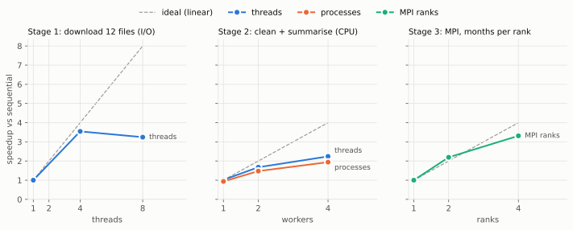

# Python concurrency benchmarks

[](https://github.com/maryam843/python-concurrency-benchmarks/actions/workflows/ci.yml)

Tested Python benchmarks that measure when threads, processes and MPI make a program faster, ending in a 4-stage pipeline over 48,722,602<!-- claim: 06_nyc_taxi_pipeline/stage2_cpu.json | yearly.rows_raw | {:,} --> NYC taxi trips. Every parallel answer is checked against the sequential answer before its time counts.

## Key results

All timings are medians from one run of `tools/run_benchmarks.py` on one 4-core cloud VM; speedups are against the sequential version.

- **Pure-Python CPU work (n = 1e7):** 4 processes ran 3.86x<!-- claim: 01_threads_vs_processes/threads_vs_processes_n10000000.json | rows[config=processes_2_per_function].speedup | {:.2f}x --> faster; 4 threads were slightly slower than sequential at 0.95x<!-- claim: 01_threads_vs_processes/threads_vs_processes_n10000000.json | rows[config=threads_2_per_function].speedup | {:.2f}x --> (the GIL lets only one thread run Python code at a time).
- **Sum of 1 to 1e8:** NumPy on one core reached 4.33x<!-- claim: 02_parallel_sum/parallel_sum.json | rows[n=100000000,method=numpy_vectorised].speedup | {:.2f}x -->, ahead of the best 4-process version (3.79x<!-- claim: 02_parallel_sum/parallel_sum.json | rows[n=100000000,method=processes_queue].speedup | {:.2f}x -->). At this size the NumPy version builds fresh 80 MB arrays, so its time follows the memory speed of the VM, not its CPU; the size of its lead changes from machine to machine.
- **A year of taxi trips with MPI:** 4 ranks on one machine were 2.61x<!-- claim: 06_nyc_taxi_pipeline/stage3_mpi.json | rows[ranks=4].speedup_vs_sequential | {:.2f}x --> faster than sequential Python, with an identical yearly summary. Downloading the 12 files with 4 threads was 3.71x<!-- claim: 06_nyc_taxi_pipeline/stage1_download.json | rows[workers=4].speedup_vs_first | {:.2f}x --> faster on that VM's network.
- **Where parallelism did not pay:** `Pool.map` over a million tiny squares ran at 0.352x<!-- claim: 03_connection_pool/pool_squares.json | rows[n=1000000,method=pool_map].speedup | {:.3f}x --> (slower than a plain loop), and for cleaning the taxi data 4 threads (2.14x<!-- claim: 06_nyc_taxi_pipeline/stage2_cpu.json | rows[method=threads,workers=4].speedup | {:.2f}x -->) and 4 processes (2.26x<!-- claim: 06_nyc_taxi_pipeline/stage2_cpu.json | rows[method=processes,workers=4].speedup | {:.2f}x -->) are too close to rank.



**Tools:** Python, threading, multiprocessing, MPI (mpi4py), NumPy, pandas, PyArrow, SQLite, pytest, Hypothesis, GitHub Actions

## Data

| Dataset | Source and licence | Size | How to get it |
|---|---|---|---|
| NYC TLC yellow taxi trips, January to December 2025, plus the taxi zone lookup | [NYC TLC Trip Record Data](https://www.nyc.gov/site/tlc/about/tlc-trip-record-data.page), published by the City of New York under the [NYC.gov terms of use](https://www.nyc.gov/home/terms-of-use.page) | 12 Parquet files, 829,973,299<!-- claim: 06_nyc_taxi_pipeline/manifest.json | total_bytes | {:,} --> bytes, 48,722,602<!-- claim: 06_nyc_taxi_pipeline/manifest.json | total_rows | {:,} --> trips | `python -m nyc_taxi.download` (checks each file against the SHA-256 values in `results/06_nyc_taxi_pipeline/manifest.json`) |
| UCI Air Quality, hourly temperatures from one station | De Vito, S. (2008), UCI Machine Learning Repository, [doi:10.24432/C59K5F](https://doi.org/10.24432/C59K5F), CC BY 4.0 | zip of 1,543,989 bytes | `python 04_sensor_monitor/download_air_quality.py` (SHA-256 checked) |
| Generated workloads (sums, squares, random loops) | made in code, seeded | n up to 1e8 | none needed |

The datasets are downloaded into `data/` (ignored by git) and never committed, because of their size and so that each user takes them from the publisher under its terms. The tests and CI use small synthetic files in the same formats (`tests/fixtures/`), and a guard stops any test from reaching the internet.

## Approach

1. **Answer first, then time.** Each parallel version must return the same result as the sequential one (or a closed form such as n(n+1)/2, or a separate pandas version) before its time is recorded. This caught an earlier parallel sum that used a 32-bit shared array and silently returned 1,784,293,664 instead of 500,000,500,000; it now uses `Array('q')` and a regression test.
2. **One timing method everywhere.** One untimed warm-up, then the median of several runs (5 in folders 01 and 02, 3 in 03 and 06, 10 in 05). Speedup is the sequential median over the method's median; efficiency divides by the workers that actually ran.
3. **Five small studies:** two pure-Python loops on threads vs processes (01); a sum of 1 to n six ways, with Amdahl and Gustafson checks (02); a semaphore-guarded connection pool for 8 processes sharing 2 connections, plus `Pool` overhead (03); producer and consumer threads with a `Condition` replaying UCI temperatures (04); MPI squares with int64 arrays and `Gatherv` or reduce only (05).
4. **A real pipeline (06):** download with threads and a SHA-256 manifest; clean with six ordered rules that remove 10.33%<!-- claim: 06_nyc_taxi_pipeline/stage2_cpu.json | yearly.removed_share | {:.2%} --> of trips; summarise each month as sums and counts (not means), so any split across threads, processes or MPI ranks gives an identical yearly result; answer five questions in SQLite.
5. **Control runs to test the explanations.** Cleaning was repeated with PyArrow limited to one thread: then processes reached 3.59x<!-- claim: 06_nyc_taxi_pipeline/stage2_cpu_arrow_1_thread.json | rows[method=processes,workers=4].speedup | {:.2f}x --> and threads only 1.92x<!-- claim: 06_nyc_taxi_pipeline/stage2_cpu_arrow_1_thread.json | rows[method=threads,workers=4].speedup | {:.2f}x -->, which shows that threads helped before because PyArrow releases the GIL. An extra MPI run with `--bind-to none` shows why 1 bound rank is slower than plain Python.
6. **Results as data.** Every result is a JSON file in `results/` with the OS, CPU, core count, memory and package versions. Figures and README tables are drawn from those files, and `tools/check_readme_claims.py` fails CI if a number in a README differs from them.

## Results

Medians on one 4-core VM (Intel Xeon 2.10 GHz, 15.7 GB, Python 3.12). Every method returned the same answer as the sequential baseline.

| Workload | Sequential baseline | 4 threads | 4 processes | Other |
|---|---|---|---|---|
| 01 pure-Python loops, n = 1e7 | 6.11 s<!-- claim: 01_threads_vs_processes/threads_vs_processes_n10000000.json | rows[config=sequential].median_s | {:.2f} s --> | 0.95x<!-- claim: 01_threads_vs_processes/threads_vs_processes_n10000000.json | rows[config=threads_2_per_function].speedup | {:.2f}x --> | 3.86x<!-- claim: 01_threads_vs_processes/threads_vs_processes_n10000000.json | rows[config=processes_2_per_function].speedup | {:.2f}x --> | |
| 02 sum of 1 to 1e8 | 1.11 s<!-- claim: 02_parallel_sum/parallel_sum.json | rows[n=100000000,method=sequential].median_s | {:.2f} s --> | 0.96x<!-- claim: 02_parallel_sum/parallel_sum.json | rows[n=100000000,method=threads].speedup | {:.2f}x --> | Queue 3.79x<!-- claim: 02_parallel_sum/parallel_sum.json | rows[n=100000000,method=processes_queue].speedup | {:.2f}x -->, shared Array 3.77x<!-- claim: 02_parallel_sum/parallel_sum.json | rows[n=100000000,method=processes_shared_array_int64].speedup | {:.2f}x -->, `Pool.map` 3.66x<!-- claim: 02_parallel_sum/parallel_sum.json | rows[n=100000000,method=pool_map].speedup | {:.2f}x --> | NumPy, 1 core: 4.33x<!-- claim: 02_parallel_sum/parallel_sum.json | rows[n=100000000,method=numpy_vectorised].speedup | {:.2f}x --> |
| 02 sum of 1 to 1e6 | 0.0105 s<!-- claim: 02_parallel_sum/parallel_sum.json | rows[n=1000000,method=sequential].median_s | {:.4f} s --> | 0.88x<!-- claim: 02_parallel_sum/parallel_sum.json | rows[n=1000000,method=threads].speedup | {:.2f}x --> | best: shared Array 1.44x<!-- claim: 02_parallel_sum/parallel_sum.json | rows[n=1000000,method=processes_shared_array_int64].speedup | {:.2f}x --> | |
| 03 square 1e6 numbers | 0.0542 s<!-- claim: 03_connection_pool/pool_squares.json | rows[n=1000000,method=sequential].median_s | {:.4f} s --> | | `Pool.map` 0.352x<!-- claim: 03_connection_pool/pool_squares.json | rows[n=1000000,method=pool_map].speedup | {:.3f}x --> | |
| 06 stage 1: download 12 files | 42.77 s<!-- claim: 06_nyc_taxi_pipeline/stage1_download.json | rows[workers=1].median_s | {:.2f} s --> | 3.71x<!-- claim: 06_nyc_taxi_pipeline/stage1_download.json | rows[workers=4].speedup_vs_first | {:.2f}x --> | | 8 threads: 6.79x<!-- claim: 06_nyc_taxi_pipeline/stage1_download.json | rows[workers=8].speedup_vs_first | {:.2f}x --> |
| 06 stage 2: clean and summarise | 5.95 s<!-- claim: 06_nyc_taxi_pipeline/stage2_cpu.json | rows[method=sequential].median_s | {:.2f} s --> | 2.14x<!-- claim: 06_nyc_taxi_pipeline/stage2_cpu.json | rows[method=threads,workers=4].speedup | {:.2f}x --> | 2.26x<!-- claim: 06_nyc_taxi_pipeline/stage2_cpu.json | rows[method=processes,workers=4].speedup | {:.2f}x --> | |
| 06 stage 2, PyArrow on one thread | 8.50 s<!-- claim: 06_nyc_taxi_pipeline/stage2_cpu_arrow_1_thread.json | rows[method=sequential].median_s | {:.2f} s --> | 1.92x<!-- claim: 06_nyc_taxi_pipeline/stage2_cpu_arrow_1_thread.json | rows[method=threads,workers=4].speedup | {:.2f}x --> | 3.59x<!-- claim: 06_nyc_taxi_pipeline/stage2_cpu_arrow_1_thread.json | rows[method=processes,workers=4].speedup | {:.2f}x --> | |
| 06 stage 3: MPI over the 12 months | 6.20 s<!-- claim: 06_nyc_taxi_pipeline/stage3_mpi.json | sequential.median_s | {:.2f} s --> | | | 4 ranks: 2.61x<!-- claim: 06_nyc_taxi_pipeline/stage3_mpi.json | rows[ranks=4].speedup_vs_sequential | {:.2f}x --> (3.41x<!-- claim: 06_nyc_taxi_pipeline/stage3_mpi.json | rows[ranks=4].speedup_vs_1_rank | {:.2f}x --> vs 1 rank) |

Two results are about correctness and memory rather than speed. The connection pool served 8<!-- claim: 03_connection_pool/connection_pool_run.json | acquired | {} --> of 8 processes and never had more than 2<!-- claim: 03_connection_pool/connection_pool_run.json | max_concurrent_holders | {} --> holders at once. For the MPI squares, rank 0 peaked at 1,573 MB<!-- claim: 05_mpi_multi_node/mpi_squares_scaling_gatherv.json | rows[n=100000000,ranks=1].peak_rss_mb_rank0_max | {:,.0f} MB --> at n = 1e8 with `Gatherv` and 238 MB<!-- claim: 05_mpi_multi_node/mpi_squares_scaling_reduce_only.json | rows[n=100000000,ranks=4].peak_rss_mb_rank0_max | {:,.0f} MB --> with reduce only on 4 ranks, against 2,969 MB<!-- claim: 05_mpi_multi_node/earlier_calculate_squares.json | rows[n=10000000,ranks=1].peak_rss_mb_rank0 | {:,.0f} MB --> at n = 1e7 for the original list-based script. Full tables, with mean and standard deviation for every row, are in each folder's README.

## Limitations

- Every timing comes from one 4-core cloud VM. Seconds do not carry over to other machines, and the ratios move too: the NumPy lead depends on memory speed, and close gaps such as threads vs processes for cleaning can change order on another VM.
- MPI ran on one machine only. There is no multi-machine measurement, so the results say nothing about network cost between nodes.
- Download speedups depend on the network path of that VM and are not a general rule.
- A year of taxi data is a real dataset but not "big data", and December fares behave differently from other months for a reason not yet known. Python's free-threaded build (no GIL) was not tested.

## How to run

Python 3.12. The MPI parts need an MPI runtime first (Linux: `sudo apt install openmpi-bin libopenmpi-dev`).

```bash
python3.12 -m venv .venv && . .venv/bin/activate
pip install -r requirements-dev.txt && pip install -e .
pip install -r requirements-mpi.txt
```

Tests, lint and checks, as CI runs them (MPI tests skip without MPI; in a root shell such as a container, set `PCB_ALLOW_ROOT=1` so Open MPI will start):

```bash
python -m pytest -q --cov --cov-report=term --cov-fail-under=85
PCB_START_METHOD=spawn python -m pytest -q
ruff check .
python tools/check_readme_claims.py
python tools/pii_scan.py --worktree
```

On Windows PowerShell, activate with `.venv\Scripts\activate` and force the start method with `$env:PCB_START_METHOD="spawn"`.

Regenerate every file in `results/` and `figures/` (downloads the datasets; each pass over the taxi year is 829,973,299<!-- claim: 06_nyc_taxi_pipeline/manifest.json | total_bytes | {:,} --> bytes):

```bash
python tools/run_benchmarks.py
```

Single demos:

```bash
python -m threads_vs_processes.benchmark --n 1000000 --repeats 3 --no-save
python 02_parallel_sum/main.py 1e7 4
python 03_connection_pool/main.py
python 04_sensor_monitor/main.py --mode data --duration 30
mpiexec -n 4 python 05_mpi_multi_node/calculate_squares.py 1e8 --no-gather
mpiexec -n 4 python 06_nyc_taxi_pipeline/stage3_mpi.py
```

The notebook version of folder 01 is `01_threads_vs_processes/threads_vs_processes.ipynb`.

## Repo structure

```text
python-concurrency-benchmarks/
  src/bench_common/          shared timing (warm-up, median) and JSON result writer
  01_threads_vs_processes/   pure-Python loops on threads vs processes, plus the notebook
  02_parallel_sum/           sum of 1 to n: threads, Queue, shared Array, Pool.map, NumPy
  03_connection_pool/        semaphore-guarded pool; squares with Pool and executors
  04_sensor_monitor/         sensor threads, queue, Condition; replays UCI temperatures
  05_mpi_multi_node/         MPI squares with Gatherv or reduce; scaling runner
  06_nyc_taxi_pipeline/      download, clean and summarise, MPI, SQLite (sql/)
  results/                   every result as JSON, with machine details
  figures/                   SVG charts drawn from results/
  tools/                     run_benchmarks, make_figures, check_readme_claims, pii_scan, ...
  tests/                     shared tests and synthetic fixtures
  docs/DECISIONS.md          the reason for each design choice
```

Each numbered folder has its own README and tests.

## Licence and credits

Code under the MIT licence, see [LICENSE](LICENSE).

- NYC Taxi and Limousine Commission (TLC) Trip Record Data, City of New York, used under the NYC.gov terms of use; the TLC gives no guarantee of accuracy.
- De Vito, S. (2008). Air Quality [Dataset]. UCI Machine Learning Repository. https://doi.org/10.24432/C59K5F. CC BY 4.0.
- `05_mpi_multi_node/calculate_squares.py` and the mpi4py send/recv example in `05_mpi_multi_node/mpi_program.py` were supplied with the original exercise and are modified here; the section headings of the folder 01 notebook also come from the original exercise. Details and the library list are in [CREDITS.md](CREDITS.md).
